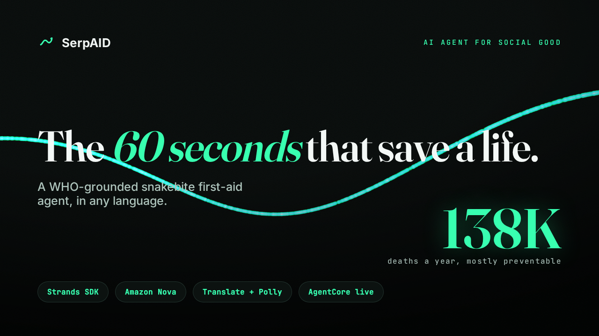
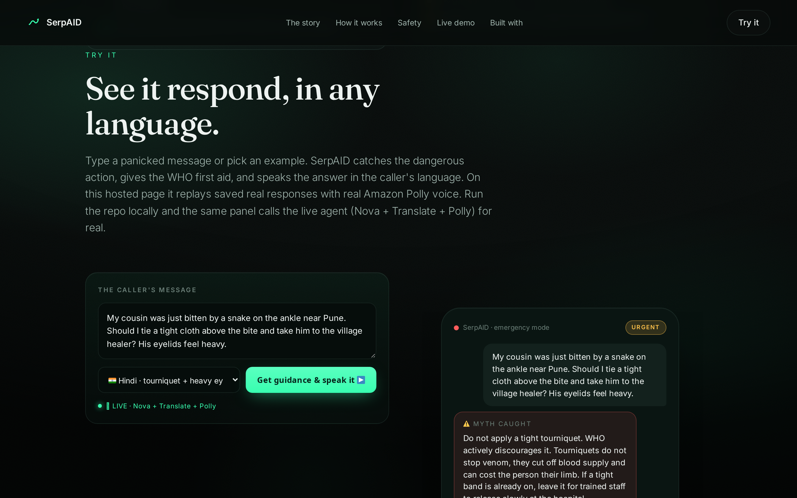
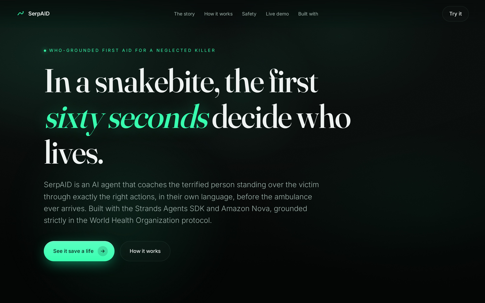
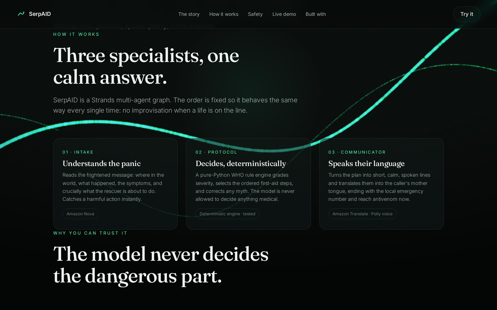
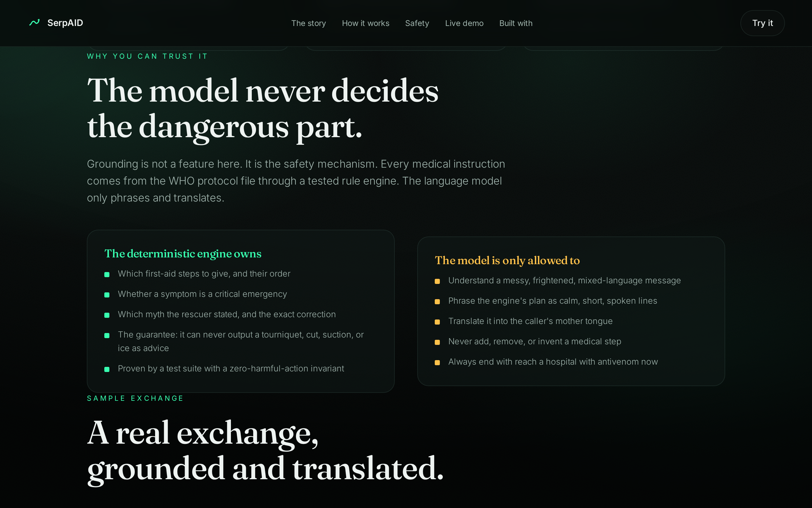
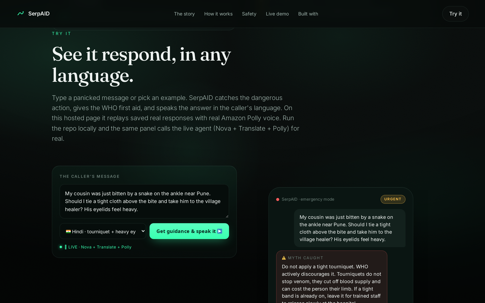

<div align="center">



# 🐍 SerpAID coaches you through the first sixty seconds of a snakebite

### A snake kills someone every five minutes, and most of those deaths are preventable. SerpAID is an AI agent that reads a panicked message and coaches the person beside the victim through exactly the right first aid, in their own language. It catches the tourniquet, the cut, the healer detour, corrects them with the WHO reason, and ends with one instruction: reach antivenom now.

[](https://strandsagents.com)
[](https://aws.amazon.com/ai/generative-ai/nova/)
[](https://aws.amazon.com/translate/)
[](#-live-deployment-proven)
[](#-the-rule-it-never-bends)
[](LICENSE)

[](https://simplynadaf.github.io/serpaid-snakebite-first-aid-agent/)
[](https://youtu.be/NhebaIE32uo)

**🐍 Built for the [Strands SDK: Workshop to Ship](https://builder.aws.com/build/hackathons/8311dcb5-1ece-3d62-a441-2e1c2ad90b86/strands-sdk-workshop-to-ship) hackathon. Focus area: Health.**

> ### The venom is only half the danger. The other half is what frightened people do in the first minutes. SerpAID replaces panic and folklore with the WHO protocol, spoken plainly, in the moment.

[The One Idea](#-the-one-idea) · [How It Works](#-how-it-works) · [The Honesty Rule](#-the-rule-it-never-bends) · [Live Deployment](#-live-deployment-proven) · [Getting Started](#-getting-started)

</div>

---

<div align="center">

### The agent, running live on Amazon Nova

<em>The live demo on the site: a caller's message comes in, the intake agent catches the harmful action, the deterministic WHO engine grades severity and passes the no-harmful-action guardrail, and the communicator answers in the caller's language with an Amazon Polly voice.</em>



</div>

---

## 🎬 See It Respond (samples + live demo)

**Want to know how it answers before running anything?** The [`samples/`](samples/) folder has real inputs, outputs, and **playable audio** for five cases across Hindi, Portuguese, Spanish, French, and English. Every sample is produced by the real pipeline (WHO engine + Amazon Translate + Amazon Polly), not hand-written.

- 📄 **[samples/SAMPLES.md](samples/SAMPLES.md)** — type-this → get-this, with the myth it catches and the full answer in each language.
- 🔊 **[samples/audio/](samples/audio/)** — the spoken Polly response for each case (the exact audio a caller hears).
- 🧾 **[samples/samples.json](samples/samples.json)** — machine-readable inputs and outputs.

| You type | Language | SerpAID catches | Severity | Hear it |
|---|---|---|---|---|
| "Should I tie a tight cloth and go to the healer? His eyelids feel heavy." | Hindi | the tourniquet myth | URGENT | [🔊](samples/audio/tourniquet-eyelids.hi.mp3) |
| "We packed the wound in ice while we wait." | Portuguese | the ice myth | URGENT | [🔊](samples/audio/ice-remote.pt.mp3) |
| "He is having trouble breathing. His uncle is sucking the venom out." | Spanish | the suction myth | EMERGENCY | [🔊](samples/audio/suction-breathing.es.mp3) |
| "The wound keeps bleeding, we are scared." | French | no harmful action | EMERGENCY | [🔊](samples/audio/bleeding-scared.fr.mp3) |
| "A hiker was bitten an hour ago, what do we do?" | English | no harmful action | URGENT | [🔊](samples/audio/no-myth-english.en.mp3) |

**Run the interactive live demo yourself** (type a message, hear the live voice):

```bash
.venv/bin/python -m uvicorn livedemo.server:app --host 127.0.0.1 --port 8808
# open http://127.0.0.1:8808  →  type a panic message, pick a language, press "Get live guidance & speak it"
```

**Or use the website's built-in demo.** The landing page's **Live demo** section ([`docs/index.html`](docs/index.html) / the hosted site) has an interactive panel: pick an example, and it shows the response and plays the Amazon Polly voice. The hosted page is fully static and free to host, replaying saved real responses. To drive the agent live yourself, run the local bridge above (`livedemo/`) or call the deployed Amazon Bedrock AgentCore endpoint.

This calls the real WHO engine, Amazon Translate, and Amazon Polly on each request. Regenerate the samples anytime with `PYTHONPATH=. .venv/bin/python scripts/make_samples.py`.

---

## 📸 Screenshots

<div align="center">

**The hero: in a snakebite, the first sixty seconds decide who lives**



**How it works: three specialists, one calm answer (intake, protocol, communicator)**



**Why you can trust it: the model never decides the dangerous part**



**The interactive demo on the site: pick an example, see the response, and hear the Amazon Polly voice**



</div>

---

**📖 Table of Contents**
- [Screenshots](#-screenshots)
- [The Problem (a neglected, preventable killer)](#-the-problem)
- [The One Idea](#-the-one-idea)
- [The Eight Myths It Catches](#-the-eight-myths-it-catches)
- [Why Coaching Beats a Leaflet](#-why-coaching-beats-a-leaflet)
- [How It Works](#-how-it-works)
- [The Rule It Never Bends](#-the-rule-it-never-bends)
- [An Honest Safety Scorecard](#-an-honest-safety-scorecard)
- [Live Deployment, Proven](#-live-deployment-proven)
- [Tech Stack](#️-tech-stack)
- [Getting Started](#-getting-started)
- [Proof It Works](#-proof-it-works)
- [Project Structure](#-project-structure)
- [Why This Matters](#-why-this-matters)
- [An Honest Take](#-an-honest-take)
- [FAQ](#-faq)
- [License](#-license)

---

## 🤔 The Problem

The World Health Organization estimates **5.4 million snakebites a year**, with **81,410 to 137,880 deaths** and about three times as many amputations and permanent disabilities. The victims are overwhelmingly **farmers and children** in poor rural communities across Africa, Asia, and Latin America. Children often suffer faster and worse because of their smaller body mass. WHO lists snakebite envenoming as a **highest-priority Neglected Tropical Disease** with a roadmap goal to halve deaths and disability by 2030.

Highly effective treatment exists: antivenom. The tragedy is that so many deaths come from **delay and harmful first aid**, not from a lack of medicine. A tight tourniquet can cost the limb. Cutting and suction do nothing useful and add injury. A detour to a traditional healer burns the hours antivenom needs.

> So SerpAID does the part a leaflet cannot: it **listens** to the panicked bystander, **catches** the harmful action they are about to take, and **coaches** them through the WHO protocol, in their own language, in the first decisive minutes.

---

## 🐍 The One Idea

A bystander sends one frightened message. SerpAID reads it and, in a single pass:

1. **Catches the dangerous action immediately** (tourniquet, cut, suction, ice, alcohol, chasing the snake, going to a healer) and corrects it with the WHO reason.
2. **Gives the WHO first-aid steps in order** (keep calm and still, immobilise, remove constrictions, transport by vehicle, watch breathing).
3. **Escalates critical danger signs** (difficulty breathing or swallowing, spreading weakness, uncontrolled bleeding, collapse) to EMERGENCY.
4. **Speaks it in the caller's mother tongue** and ends every path with one instruction: reach a health facility with antivenom now.

---

## 🐍 The Eight Myths It Catches

SerpAID does not just say "get help". It detects the specific fatal folklore the rescuer names, and corrects it with the WHO reason:

| Myth | The WHO correction |
|---|---|
| **Tie a tight tourniquet** | WHO actively discourages it. It does not stop venom, it cuts off blood supply and can cost the limb. |
| **Cut the wound open** | WHO advises against incision. It causes bleeding and infection and removes no meaningful venom. |
| **Suck the venom out** | WHO advises against suction. It removes no venom and harms the wound and rescuer. |
| **Apply a black stone, herbs, or go to a healer** | WHO advises against these. They waste the time antivenom needs. |
| **Pack the bite in ice** | It does not slow venom and can cause cold injury. |
| **Give an electric shock** | No effect on venom, and it can injure the heart. |
| **Give alcohol** | It can speed venom absorption and hide danger signs. |
| **Catch or kill the snake** | A second bite is a real risk, and treatment does not need the snake. |

---

## 🧠 Why Coaching Beats a Leaflet

| | Snakebite info apps (the crowd) | SerpAID |
|---|---|---|
| What it does | shows a static list of do's and don'ts | **listens to the panic and coaches the next action** |
| When it helps | if you already opened it and can read it | in the moment, in the caller's own language |
| Myths | a generic list | detects the exact myth the rescuer states and rebuts it |
| Language | usually one, text only | any language via Amazon Translate, spoken via Polly |
| Safety design | trusts the reader | a deterministic engine the model can never override |
| Honest about limits | rarely | a tested zero-harmful-action guarantee |

---

## 🧠 How It Works

A deterministic Strands multi-agent **Graph** with a fixed order, so it behaves the same way every time. No improvisation when a life is on the line.

```
 🧑 A panicked message: where, what happened, the symptoms, what the rescuer is about to do
      │
      ▼
 🟢 intake agent  (Amazon Nova)                              understands the panic
      │   extracts country, language, danger signs, intended action
      │   calls check_myth early so a harmful action is caught at once
      ▼
 🟢 protocol agent  (deterministic WHO engine, no model)     the DECISION
      │   grades severity, selects the ordered first-aid steps, picks the myth correction
      │   guardrail: can never output tourniquet / cut / suck / ice as advice
      ▼
 ✍️ communicator agent  (Amazon Translate + Polly)           the WORDS
      │   phrases the plan as calm, short lines, then translates to the mother tongue
      ▼
 📜 myth correction + 5 WHO steps + danger signs + emergency number + reach antivenom now
```

- **`serpaid/data/protocol.json`** reproduces WHO snakebite first-aid guidance: the do-steps, the danger signs, the eight myths, and emergency numbers by region. Nothing is invented.
- **`serpaid/engine.py`** is the heart: it grades severity, selects the ordered steps, detects the myth, and enforces the no-harmful-action guardrail. No model, fully tested.
- **`serpaid/tools.py`** are the Strands tools: assess, myth-check, Amazon Translate, Amazon Location Service (with a graceful fallback).
- **`serpaid/graph.py`** wires the three agents into the intake to protocol to communicator graph on Amazon Nova.

---

## 🚫 The Rule It Never Bends

A tool about a life-or-death emergency cannot invent a medical instruction. So **the deterministic engine decides everything medical; Amazon Nova only phrases and translates.** The model is forbidden from adding, removing, or inventing a first-aid step. Every reply is assembled from the WHO protocol file through a tested rule engine, and a runtime guardrail plus a test invariant both assert that no forbidden action (tourniquet, cut, suction, ice) can ever appear as advice. When in doubt, SerpAID escalates and says reach a hospital now, it never guesses.

---

## ✅ An Honest Safety Scorecard

Because this guides a real emergency, the safety guarantees are proven, not claimed. The test suite asserts:

```
safety invariants (tests/test_engine.py, 22 tests)
  myth detection:        catches all 8 fatal myths with a grounded WHO correction
  severity escalation:   every critical danger sign escalates to EMERGENCY
  never "safe":          no bite is ever graded safe (WHO: treat all as venomous)
  always transport:      every plan ends in reach a facility with antivenom now
  zero harmful actions:  across the full matrix, advice never contains a tourniquet,
                         cut, suction, or ice   [the single most important guarantee]
```

Run it yourself, no AWS and no GPU needed:

```bash
python -m pytest tests/ -q
```

---

## 🛰️ Live Deployment, Proven

SerpAID is deployed and running on **Amazon Bedrock AgentCore Runtime**, with CloudWatch logs and OpenTelemetry traces enabled:

```
arn:aws:bedrock-agentcore:us-east-1:<ACCOUNT_ID>:runtime/serpaid-G2FMzKGEoy
```

A live invocation of the hosted endpoint is captured in `demo/live-agentcore-invocation.json`. In it, the running agent catches the tourniquet and the village healer as harmful, grades the drooping eyelids as serious, gives the WHO first-aid steps in order, and delivers the whole plan in Marathi with the 108 emergency number.

---

## 🛠️ Tech Stack

| Component | Technology |
|---|---|
| 🧠 The agent framework | **Strands Agents SDK**, a three-node multi-agent graph |
| 🐍 The reasoning and language | **Amazon Nova Pro** (sponsored credits cover Nova, not Claude) |
| 🌍 The mother-tongue output | **Amazon Translate** (Hindi, Marathi, Tamil, Telugu, Swahili, and more) |
| 🔊 The spoken guidance | **Amazon Polly** (long-form voice) |
| 📍 Nearest care | **Amazon Location Service**, with a graceful emergency-number fallback |
| 🛰️ Live hosting | **Amazon Bedrock AgentCore Runtime** with observability |
| 🛟 Never hard-fails | a deterministic engine owns every medical decision |
| ✅ Checks | `tests/test_engine.py`, 22 assert-based tests, no server and no GPU needed |

---

## 🚀 Getting Started

```bash
# 1. set up (Python 3.10+)
python3.11 -m venv .venv && source .venv/bin/activate
pip install -r requirements.txt

# 2. prove the safety core (no AWS needed)
python -m pytest tests/ -q

# 3. run the full multilingual agent (needs AWS creds + Bedrock Nova access)
python -m serpaid.graph

# 4. deploy a live endpoint on AgentCore
python deploy.py            # prints the agent ARN
```

**Prerequisites:** Python 3.10+, AWS credentials with Amazon Bedrock Nova access in us-east-1.

---

## ✅ Proof It Works

```
$ python -m pytest tests/ -q
......................                                                   [100%]
22 passed in 0.03s
```

On the sample emergency ("a snake bit my cousin, should I tie a cloth and go to the healer, his eyelids feel heavy"), SerpAID catches the tourniquet and the healer, grades it EMERGENCY on the drooping eyelids, gives the five WHO steps in order, and answers in Marathi with 108.

---

## 📁 Project Structure

```
serpaid-snakebite-first-aid-agent/
├── README.md
├── LICENSE                        # MIT
├── requirements.txt
├── api.py                         # AgentCore entrypoint
├── deploy.py                      # AgentCore launch
├── serpaid/
│   ├── data/protocol.json         # WHO do-steps, danger signs, 8 myths, emergency numbers
│   ├── engine.py                  # ★ deterministic rule engine + safety guardrail
│   ├── tools.py                   # Strands tools: assess, myth-check, translate, locate
│   └── graph.py                   # the intake to protocol to communicator graph on Nova
├── tests/
│   └── test_engine.py             # 22 safety invariants incl. zero-harmful-action
├── web/                           # the ultra-premium Three.js landing page
├── demo/                          # narration, final video, screenshots, live-run clip
├── scripts/                       # audio generation, screenshots, recording, thumbnail
└── docs/                          # Builder Center article, submission kit, LinkedIn post
```

---

## 💡 Why This Matters

**Because the deaths are preventable.** Antivenom works. What kills people is the delay and the harmful folklore in the first minutes. A calm, correct, multilingual voice in that window attacks the actual cause of death, not just the symptom.

**Because grounding is the safety mechanism, not a feature.** Every medical instruction is computed from the WHO protocol in code you can read, never conjured by a model you cannot inspect. The model is confined to phrasing and translation.

**Because it reaches the people the apps forget.** It works in the caller's own language, it can speak aloud for someone who cannot read, and it is open source under MIT so it cannot be sunset or paywalled.

---

## 🧾 An Honest Take

**What is genuinely strong**
- The agent is load-bearing: a real Strands multi-agent graph on Nova, deployed live on AgentCore.
- The safety story is provable: a deterministic engine plus a tested zero-harmful-action guarantee.
- Grounded strictly in WHO guidance, with the personal reason it exists kept front and center.

**Honest limits**
- Myth detection is keyword based and runs on English today; translating the input before the scan is the next step.
- First aid is a safe universal step set; region-specific technique (elapid versus viper) is a planned extension.
- Nearest care is a safe fallback to the local emergency number, not live routing, because no clean global antivenom-facility dataset exists.
- Safety is proven by tests today; the real proof is a field pilot measuring time from bite to antivenom.

---

## ❓ FAQ

**Is the agent real or a prompt trick?**
Real. It is a Strands multi-agent graph on Amazon Nova, deployed live on Bedrock AgentCore. The deterministic engine decides every medical instruction; Nova only phrases and translates.

**Can it recommend something dangerous?**
No. A tested invariant and a runtime guardrail both guarantee that advice never contains a tourniquet, cut, suction, or ice. Those appear only as corrections.

**Does it diagnose the snake or give treatment?**
No. It gives WHO first-aid guidance and always ends in reaching a facility with antivenom now. It does not identify the snake or the venom, and it does not replace a hospital.

**What languages does it speak?**
Any language Amazon Translate supports, including Hindi, Marathi, Tamil, Telugu, Bengali, Swahili, French, Spanish, and more, with spoken output via Amazon Polly.

---

## 🔗 Links

- 🐍 Hackathon: https://builder.aws.com/build/hackathons/8311dcb5-1ece-3d62-a441-2e1c2ad90b86/strands-sdk-workshop-to-ship
- 📦 Repo: https://github.com/simplynadaf/serpaid-snakebite-first-aid-agent
- 🖥️ Live site: https://simplynadaf.github.io/serpaid-snakebite-first-aid-agent/
- ▶️ Demo video: https://youtu.be/NhebaIE32uo

<div align="center">

</div>

---

## 📝 License

MIT. See [LICENSE](LICENSE).

---

<div align="center">

## 👨‍💻 Author

**Sarvar Nadaf** · Cloud Architect · AI Infrastructure & DevOps

[Portfolio](https://sarvarnadaf.com) · [LinkedIn](https://www.linkedin.com/in/sarvar04/) · [GitHub](https://github.com/simplynadaf) · [Dev.to](https://dev.to/sarvar_04) · [YouTube](https://www.youtube.com/@sarvar-nadaf) · [AWS Builder Center](https://builder.aws.com/community/@sarvar)

*The deterministic WHO engine decides the medicine · Amazon Nova speaks it in your language · the model never decides the dangerous part*

**If this could help someone in the first sixty seconds of a snakebite, consider a ⭐**

</div>
