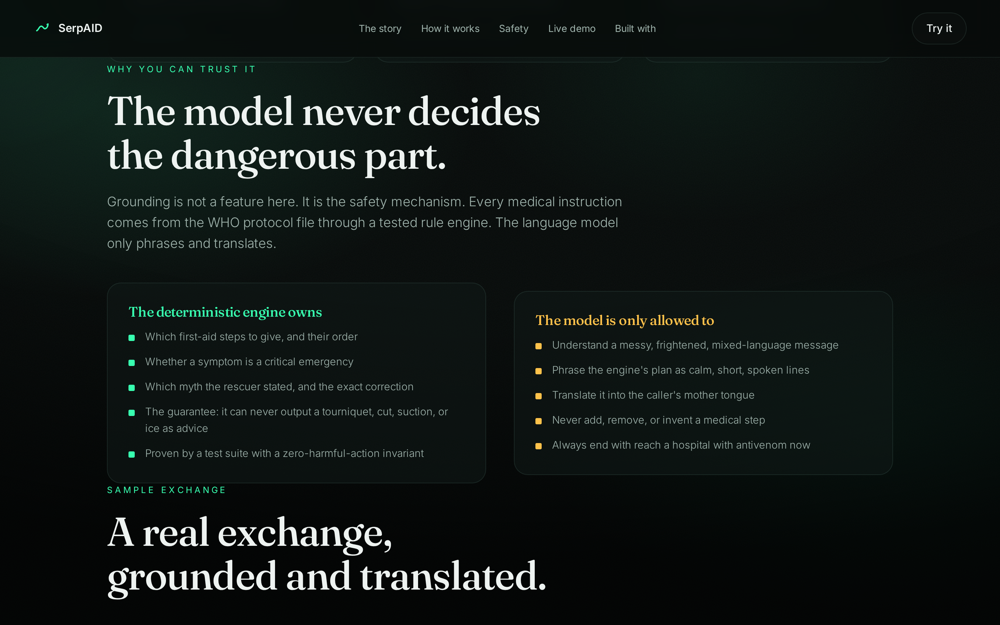
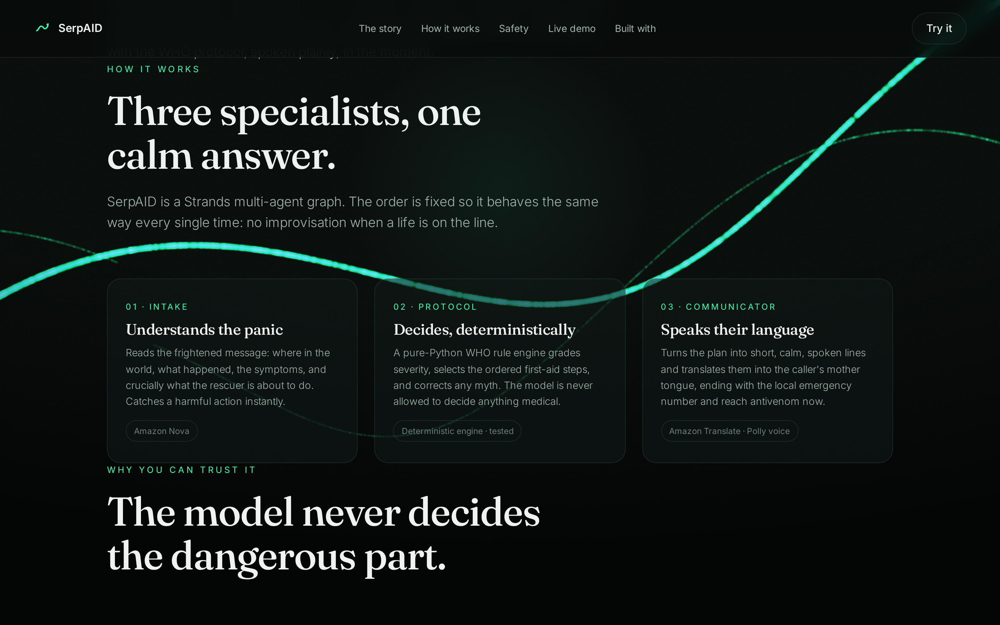
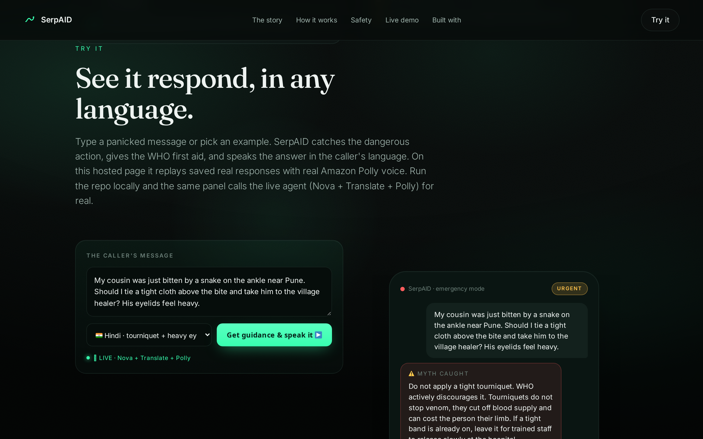

A snake bit my cousin on the ankle. He was in a field near Pune, and the people who loved him did everything wrong in the first ten minutes. Someone shouted to tie a cloth tight above the bite. Someone else said take him to the village healer first. We burned the minutes that mattered most on exactly the things that make a snakebite worse.

He lived. Tens of thousands of people every year do not.

That day taught me something the data confirmed later: in a snakebite, the venom is only half the danger. The other half is what frightened people do in the first sixty seconds. And that half is a software problem.

So I built **SerpAID**, an AI agent that reads one panicked message and coaches the person standing over the victim through the correct WHO first aid, in their own language, before the ambulance arrives. This is the build, the one architecture decision that matters, and the part most people get wrong when they put an LLM near a life.

---

## The problem, in real numbers

The World Health Organization estimates **5.4 million snakebites a year**, with **81,410 to 137,880 deaths** and about three times as many amputations and permanent disabilities. The victims are overwhelmingly farmers and children in poor rural communities across Africa, Asia, and Latin America. WHO lists snakebite envenoming as a highest-priority Neglected Tropical Disease with a goal to halve deaths and disability by 2030.

Here is the part that makes it a software problem. Antivenom works. What kills people is **delay and harmful folklore** in the first minutes:

- a tight tourniquet that cuts off blood supply and costs the limb
- cutting the wound, which does nothing but add injury
- sucking the venom out, which removes no venom and harms the rescuer
- packing the bite in ice
- a detour to a traditional healer that burns the hours antivenom needs

Every one of those is a decision a frightened bystander makes in the first sixty seconds. A calm, correct voice in that window is the intervention.

---

## The one decision that matters: the model never decides the dangerous part

Here is the thing I want to convince you of, because it is the whole design.

When you put a large language model near a life-or-death instruction, your instinct is to let it do the work. Read the message, figure out the first aid, write the answer. That instinct is wrong. An LLM that hallucinates a temperature is annoying. An LLM that hallucinates "yes, apply a tourniquet" gets someone's arm amputated.

So in SerpAID the language model is **not allowed to decide anything medical.**

Every medical instruction lives in a WHO protocol file and flows through a deterministic Python rule engine. That engine decides which first-aid steps to give, whether a symptom is a critical emergency, and which myth the rescuer just stated. Amazon Nova is only allowed to do three things: understand a messy, frightened message, phrase the engine's plan as calm short lines, and translate it into the caller's language. It never adds, removes, or invents a medical step.

Grounding here is not a feature. It is the safety mechanism.

The engine carries a guarantee, and I prove it with tests rather than claim it:

```python
# tests/test_engine.py - the single most important test
@pytest.mark.parametrize("signs,text,region", [
    ([], "he was bitten on the leg", "IN"),
    (["trouble_breathing"], "should I tie a tourniquet", "KE"),
    (["persistent_bleeding"], "can I cut it open", "NG"),
    (["severe_swelling"], "putting ice on it", "US"),
])
def test_engine_never_recommends_a_forbidden_action_as_advice(signs, text, region):
    plan = build_plan(signs, text, region)
    advice = " ".join(s["detail"].lower() for s in plan["steps"]) + " " + plan["closing"].lower()
    for phrase in ["apply a tourniquet", "cut the wound open", "suck the venom", "pack the bite in ice"]:
        assert phrase not in advice
```

The myths it catches (the tourniquet, the cut, the suction, the healer, ice, electric shock, alcohol, chasing the snake) only ever appear in the output as **corrections**, never as advice. A runtime guardrail and a test invariant both enforce that. Across the full test matrix, **22 passing tests**, the advice contains zero harmful actions.



---

## How it works: a three-agent graph

SerpAID is a **Strands Agents SDK** multi-agent graph with a fixed order, so it behaves the same way every time. No improvisation when a life is on the line.

```
 A panicked message: where, what happened, the symptoms, what the rescuer is about to do
      |
      v
 intake agent  (Amazon Nova)        understands the panic
      |   extracts country, language, danger signs, intended action
      v
 protocol agent  (deterministic WHO engine, no model)      the DECISION
      |   grades severity, selects the 5 ordered steps, picks the myth correction
      |   guardrail: can never output tourniquet / cut / suck / ice as advice
      v
 communicator agent  (Amazon Translate + Amazon Polly)     the WORDS
      |   phrases the plan, translates to the mother tongue, speaks it aloud
      v
 myth correction + WHO steps + danger signs + emergency number + reach antivenom now
```

Why a fixed **graph** and not a free-form swarm? Because a safety tool should be reproducible and legible. I know exactly what runs, in what order, every single time. The workshop this was built for is literally titled "From Simple Loops to Multi-Agent Swarms," and a graph is the deliberate, demo-reliable choice inside that space.

The tool shape in Strands is refreshingly plain. The model reads the docstring to route:

```python
from strands import Agent, tool

@tool
def assess_snakebite(reported_signs: list[str], what_user_is_doing: str, region_code: str) -> dict:
    """Return the deterministic WHO first-aid plan for a snakebite.
    The single source of truth for every reply. The model relays this; it never invents it."""
    return build_plan(reported_signs, what_user_is_doing, region_code or None)
```

The LLM never computes the plan. It calls the tool, and the tool is boring, tested Python. That is the point.



---

## The AWS stack, and why each piece

| Piece | Job |
|---|---|
| **Strands Agents SDK** | the three-node multi-agent graph |
| **Amazon Nova Pro** | reasoning and language (sponsored credits cover Nova, not Claude) |
| **Amazon Translate** | mother-tongue output: Hindi, Spanish, French, Portuguese, and more |
| **Amazon Polly** | a spoken voice, so it reaches someone who cannot read |
| **Amazon Location Service** | nearest care, with a graceful fallback to the local emergency number |
| **Amazon Bedrock AgentCore Runtime** | live serverless hosting with observability |

One sharp detail that cost me a demo and might cost you one: **AWS event and hackathon credits cover Amazon Nova, not Claude.** The workshop defaults to Claude. If you run on sponsored credits, switch the model id or you will hit access errors.

```python
from strands.models import BedrockModel
model = BedrockModel(model_id="amazon.nova-pro-v1:0")  # not Claude, on sponsored credits
```

---

## See it respond, with voice, for free

The hardest part of a safety demo is proving it works without faking it. So I did two things.

First, the landing page has an **interactive demo** you can try. Pick a real case, watch SerpAID catch the dangerous action, read the WHO answer in the caller's language, and hear the Amazon Polly voice. The hosted page is fully static and replays saved real responses, so it costs nothing to run. Clone the repo and the same panel calls the live agent for real.

Second, every sample in the repo is produced by the real pipeline, not hand-written. Five cases across five languages, with the actual input, the actual output, and a playable audio clip of the Polly voice a caller would hear.



Here is the whole thing working end to end in under three minutes:



And the code, the exact WHO protocol engine, and the tests:



---

## A real exchange

A caller writes, in a panic: *a snake bit my cousin on the ankle near Pune, should I tie a tight cloth and take him to the village healer, his eyelids feel heavy.*

SerpAID, in one pass:

1. Flags the **tourniquet** and the **healer** as harmful, and explains why in WHO terms.
2. Grades the **drooping eyelids** as a neurotoxic danger sign and escalates.
3. Gives the five WHO first-aid steps in order.
4. Delivers all of it in **Hindi**, spoken aloud by Polly, ending with 108.

The model wrote none of the medicine. It phrased and translated what the engine decided.

---

## What I would build next, honestly

Naming the limits is part of building something you can trust in health.

- **Myth detection is keyword based and runs on English today.** A caller who writes the same intent in Hindi may not trigger it yet. The fix is to translate the incoming message before the myth scan, so the safety net works regardless of input language.
- **First aid is one safe universal step set.** Correct technique can differ by snake family, for example pressure immobilisation for some neurotoxic bites versus not for tissue-destroying ones. I would branch the engine on region, grounded in the regional annexes of the WHO guidance, without ever letting the model make that call.
- **Nearest care is a safe fallback, not live routing.** There is no clean global dataset of which facilities actually stock antivenom, so the agent returns the correct local emergency number. A curated country-level directory would make it exact.
- **The measurement that matters is a field pilot** with a community health program, measuring the one number that decides outcomes: time from bite to antivenom.

---

## The honest take

SerpAID gives first-aid guidance grounded in the WHO protocol. It does not diagnose the snake, does not identify venom type, and does not replace a hospital. Every path it gives ends in reaching a facility with antivenom now.

But the lesson generalizes past snakebites. The strongest agents I have seen do not let the model do everything. They put a deterministic, tested core in charge of the decisions that matter, and they confine the LLM to the thing it is actually good at: understanding a messy human and speaking plainly back. For anything where a wrong answer has a real cost, grounding is not polish. It is the architecture.

If you build agents, I would love your feedback on exactly one thing: **where do you draw the line between what the model decides and what deterministic code decides?** For a safety agent I drew it hard. I am curious where you draw it.

- Live demo: [the interactive SerpAID site](https://simplynadaf.github.io/serpaid-snakebite-first-aid-agent/)
- Builder Center project: [SerpAID on AWS Builder Center](https://builder.aws.com/project/3LY2kzBnTkUIA5AnwAQe9gShRDY/serpaid-a-who-grounded-snakebite-first-aid-ai-agent-built-with-strands-sdk-and-amazon-nova)
- Built for the [Strands SDK: Workshop to Ship](https://builder.aws.com/build/hackathons/8311dcb5-1ece-3d62-a441-2e1c2ad90b86/strands-sdk-workshop-to-ship) hackathon

---

*Follow me for more on AWS architecture, DevOps, and AI Infrastructure:*
*[Portfolio](https://sarvarnadaf.com) | [LinkedIn](https://www.linkedin.com/in/sarvar04/) | [Dev.to](https://dev.to/sarvar_04) | [YouTube](https://www.youtube.com/@sarvar-nadaf) | [Email](mailto:simplynadaf@gmail.com) | [AWS Builder Center](https://builder.aws.com/community/@sarvar) | [X](https://x.com/SarvarN_04)*
